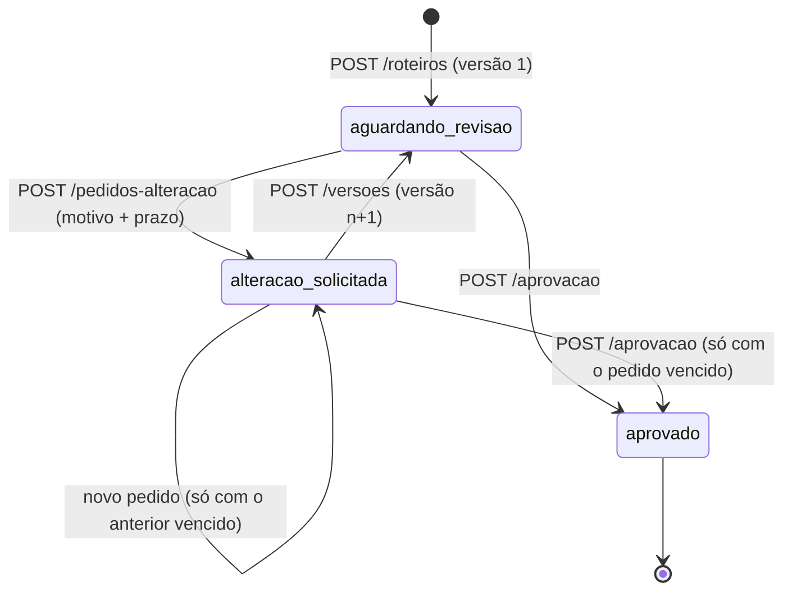

# Revisão de roteiro

API para o fluxo de revisão de roteiro entre criador e marca. O criador envia o roteiro, a marca pede alteração com motivo e prazo, o criador manda outra versão e a marca aprova. Cada versão fica guardada com o próprio estado, e o histórico de eventos pode ser consultado a qualquer momento.

Stack: Node 22.13+, TypeScript, Hono, zod, `node:sqlite`, Vitest e k6 (via Docker).

## Como rodar

```bash
npm install
npm run dev          # API em http://localhost:3000, banco em data/roteiros.db
npm test             # unitários + integração (sqlite em memória, relógio controlado)
npm run typecheck
npm run load         # precisa de Docker; sobe a API na porta 3101 com banco temporário
```

`PORT` e `DB_PATH` mudam a porta e o arquivo do banco.

## Estados

`GET /roteiros/:id` traz `estado`, `versao_atual`, `acoes_permitidas` e `pedido_alteracao_aberto`. Com esses campos o cliente sabe qual é o próximo passo.



| Estado do roteiro | Ações permitidas | Outras ações |
|---|---|---|
| `aguardando_revisao` | `solicitar_alteracao`, `aprovar` | nova versão: 409 `AGUARDANDO_REVISAO` |
| `alteracao_solicitada`, pedido no prazo | `enviar_nova_versao` | aprovar ou pedir de novo: 409 `AGUARDANDO_NOVA_VERSAO` |
| `alteracao_solicitada`, pedido vencido | `enviar_nova_versao`, `solicitar_alteracao`, `aprovar` | |
| `aprovado` | nenhuma | tudo: 409 `ROTEIRO_APROVADO` |

Cada versão também tem estado (`aguardando_revisao`, `alteracao_solicitada` ou `aprovada`). Texto e número de uma versão nunca mudam: um trigger no sqlite recusa `UPDATE` do conteúdo e `DELETE` de versão, e a versão antiga continua em `GET /roteiros/:id/versoes/1`.

## Endpoints

| Método | Caminho | Corpo |
|---|---|---|
| POST | `/roteiros` | `{ "titulo", "conteudo" }` |
| GET | `/roteiros/:id` | |
| GET | `/roteiros/:id/versoes/:numero` | |
| GET | `/roteiros/:id/historico` | |
| POST | `/roteiros/:id/pedidos-alteracao` | `{ "motivo", "prazo": "AAAA-MM-DD", "versao"? }` |
| POST | `/roteiros/:id/versoes` | `{ "conteudo" }` |
| POST | `/roteiros/:id/aprovacao` | `{ "versao"? }` (corpo pode ser omitido) |

Os três `POST` sobre um roteiro aceitam `Idempotency-Key`. O campo opcional `versao` diz qual versão a marca está revisando; se não for a atual, a resposta é 409 `VERSAO_DESATUALIZADA`.

Erros vêm como `{ "error": { "code", "message", "details"? } }`. A ordem das checagens é: forma da entrada (400), roteiro existe (404), estado permite a ação (409), regra que depende do relógio (422 `PRAZO_VENCIDO`). Assim, um pedido com prazo vencido num roteiro aprovado recebe 409 `ROTEIRO_APROVADO`.

Validação e limites: todo corpo, parâmetro de rota e `Idempotency-Key` passa por um schema zod (`src/schemas.ts`). Campos desconhecidos são ignorados e textos são aparados. Recebem 400 os casos de JSON malformado, corpo que não é objeto, `Content-Type` diferente de JSON com corpo, texto vazio ou só com caracteres invisíveis, texto com caracteres de controle como NUL (`CARACTERE_INVALIDO`; tab e quebras de linha passam), `titulo` com mais de 200 caracteres, `conteudo` com mais de 50 mil, `motivo` com mais de 2 mil, `versao` que não é inteiro positivo, número de versão na URL fora de `^[1-9]\d*$` e prazo com ano abaixo de 100 ou acima de 9999 (só o formato limita a data; não há teto de negócio). Corpo acima de 1 MB recebe 413, e rota, método ou id inexistente recebe 404 em JSON. Erro inesperado vira 500 genérico, sem stack trace. Os casos estão em `test/integration/payloads-invalidos.test.ts`.

## Regra do prazo

O prazo é uma data civil `AAAA-MM-DD` no fuso da marca (`America/Sao_Paulo`) e vale até 23:59:59.999 desse dia em São Paulo. `fimDoDia` (`src/prazo.ts`) calcula esse instante com `Intl`, sem `-03:00` fixo; os testes unitários incluem dias de 2018 e 2019 com horário de verão.

Com prazo `2026-03-12` e relógio controlado, o pedido passa em `2026-03-13T02:59:59.999Z` e recebe 422 `PRAZO_VENCIDO` em `2026-03-13T03:00:00.000Z`. Em `2026-03-13T01:30:00Z` o UTC já está no dia 13, mas em São Paulo ainda é dia 12: o prazo do dia 12 vale e o do dia 11 não (`test/integration/pedido-alteracao.test.ts`).

Pedido com prazo que já passou não vale, e isso vale também para o pedido que venceu depois de aberto. Até o último instante do prazo, só o criador age (a marca recebe 409). A partir do primeiro instante do dia seguinte, a marca volta a ter saída: pode fazer um pedido novo na mesma versão, que substitui o vencido, ou aprovar a versão atual. Nos dois casos o pedido vencido fica guardado com `situacao: "expirado"` em `pedidos_expirados` da versão, e o histórico ganha um evento `pedido_expirado`. Os testes com relógio controlado estão em `test/integration/pedido-vencido.test.ts`.

O criador continua podendo reenviar depois do prazo. A versão nova sai com `enviada_apos_prazo: true` e o evento `reenviado` registra `apos_prazo: true`; a marca vê o atraso e decide.

## Exemplo real

Chamadas feitas contra a API rodando localmente, em 2026-10-10 (as respostas de erro de validação e o 422 são de uma rodada anterior do mesmo dia, com o mesmo código). Rodei na porta 3101 e troquei para 3000 aqui. Mostro só os campos que interessam a cada passo (filtrei com `jq`); a resposta completa traz também `versoes`, `criado_em` e `atualizado_em`.

```bash
curl -s -X POST localhost:3000/roteiros -H 'content-type: application/json' \
  -d '{"titulo":"Campanha protetor solar","conteudo":"Abro mostrando o produto na praia e falo do FPS 50."}'
# 201 {"id":"3df64215-9084-4389-bed4-f9f32fdd9d6f","estado":"aguardando_revisao","versao_atual":1,"acoes_permitidas":["solicitar_alteracao","aprovar"]}

curl -s -X POST localhost:3000/roteiros/$ID/pedidos-alteracao -H 'content-type: application/json' \
  -d '{"motivo":" ","prazo":"17/10/2026"}'
# 400 {"error":{"code":"MOTIVO_OBRIGATORIO","message":"Informe o campo \"motivo\".","details":[{"campo":"motivo","motivo":"Informe o campo \"motivo\"."},{"campo":"prazo","motivo":"O prazo precisa ser uma data válida no formato AAAA-MM-DD."}]}}

curl -s -X POST localhost:3000/roteiros/$ID/pedidos-alteracao -H 'content-type: application/json' \
  -d '{"motivo":"Trocar o gancho","prazo":"2026-10-01"}'
# 422 {"error":{"code":"PRAZO_VENCIDO","message":"O prazo 2026-10-01 já passou no fuso da marca (America/Sao_Paulo)."}}

curl -s -X POST localhost:3000/roteiros/$ID/pedidos-alteracao -H 'content-type: application/json' \
  -d '{"motivo":"Trocar o gancho dos 3 primeiros segundos.","prazo":"2026-10-17","versao":1}'
# 201 {"estado":"alteracao_solicitada","acoes_permitidas":["enviar_nova_versao"],"pedido_alteracao_aberto":{"id":"44ad03b9-03d1-4726-8659-45e1ac3a78d4","versao":1,"situacao":"aberto","motivo":"Trocar o gancho dos 3 primeiros segundos.","prazo":"2026-10-17","fuso":"America/Sao_Paulo","prazo_fim":"2026-10-17T23:59:59.999-03:00","prazo_fim_utc":"2026-10-18T02:59:59.999Z","vencido":false,"criado_em":"2026-10-10T04:14:36.501Z","expirado_em":null}}

curl -s -X POST localhost:3000/roteiros/$ID/versoes -H 'content-type: application/json' -H 'Idempotency-Key: reenvio-v1' \
  -d '{"conteudo":"Abro com a pergunta: você reaplica o protetor?"}'
# 201 (versão 2 criada). A mesma chamada de novo devolve 201 com os headers
# idempotent-replayed: true e estado-atual: aguardando_revisao, sem criar versão 3.

curl -s -X POST localhost:3000/roteiros/$ID/aprovacao -H 'content-type: application/json' -d '{"versao":2}'
# 200 {"estado":"aprovado","versao_atual":2,"acoes_permitidas":[],"aprovacao":{"versao":2,"aprovado_em":"2026-10-10T04:14:36.544Z"}}

curl -s -X POST localhost:3000/roteiros/$ID/versoes -H 'content-type: application/json' -d '{"conteudo":"mais uma"}'
# 409 {"error":{"code":"ROTEIRO_APROVADO","message":"O roteiro já foi aprovado; a revisão está encerrada."}}

curl -s localhost:3000/roteiros/$ID/versoes/1
# 200 {"numero":1,"estado":"alteracao_solicitada","conteudo":"Abro mostrando o produto na praia e falo do FPS 50.","pedido_alteracao":{"situacao":"atendido", ...}, ...}

curl -s localhost:3000/roteiros/$ID/historico
# 200 eventos: enviado (v1), alteracao_solicitada (v1, com motivo e prazo), reenviado (v2), aprovado (v2)
# (com um pedido vencido substituído ou aprovado por cima, aparece também pedido_expirado)
```

## Por que essa solução

Revisão de roteiro tem poucas ações por roteiro, espalhadas ao longo de dias. Um processo Node com sqlite serializando as escritas dá conta disso com folga, e as garantias ficam em restrições do banco que eu consigo testar: chave primária no número da versão, um pedido por versão e um índice único parcial que permite uma aprovação por roteiro. Cada ação roda inteira numa transação `BEGIN IMMEDIATE`. Não usei Redis nem lock distribuído porque nenhuma ação tem efeito fora do banco. Detalhes de idempotência, concorrência e do caminho para várias instâncias estão em [docs/concorrencia.md](docs/concorrencia.md).

Teste de carga: 100 usuários virtuais por 20 s disputando 10 roteiros, com 10% de payloads inválidos. Na última execução, nesta máquina: p95 de 34,82 ms, 4231 req/s, 0% de falha, 100% dos checks e invariantes conferidas no banco. O limite do k6 para o p95 é 500 ms, folgado de propósito para máquinas mais lentas; checks, taxa de erro e invariantes continuam rígidos. Cenário e saída em [docs/carga.md](docs/carga.md).

## O que ficou de fora

- Autenticação e papéis. Qualquer cliente pode agir como marca ou como criador, e a API não registra quem fez cada ação.
- Notificações para criador e marca.
- Listagem e busca de roteiros. Só existe consulta por id.
- `Idempotency-Key` em `POST /roteiros`, porque a chave é guardada por roteiro e na criação ainda não há roteiro.
- Fuso por marca: hoje é fixo em `America/Sao_Paulo`.
- Upload, vídeo e interface, como o enunciado permite.

## Decisões que eu deixaria diferentes com mais tempo

- O fuso viria do cadastro da marca, guardado junto do pedido, em vez de uma constante.
- O reenvio após o prazo é aceito e marcado. Talvez a marca devesse escolher por campanha entre aceitar, recusar ou prorrogar, e prorrogação viraria um evento próprio.
- `GET /roteiros/:id` traz todas as versões com conteúdo. Com 50 versões por roteiro, a carga recebeu centenas de MB em 20 s. Eu paginaria as versões e deixaria o conteúdo só no endpoint da versão.
- O histórico guarda `dados` como JSON livre. Eu tiparia por tipo de evento e incluiria o autor de cada ação.
- As chaves de idempotência nunca expiram. Colocaria validade e limpeza periódica.
- A repetição por idempotência devolve a foto da primeira resposta, com o estado atual só no header `Estado-Atual`. Com mais tempo eu discutiria com quem consome a API se o corpo deveria trazer o estado atual.

## Uso de IA

O código, os testes e este README foram produzidos com Claude Code (Claude Opus) a partir do enunciado do desafio. A IA também rodou os testes, o teste de carga e as chamadas com curl usadas nos exemplos.

O que eu revisei: as regras de negócio e os testes. Rodei a suíte e o teste de carga localmente e conferi os exemplos do README contra a API rodando.
