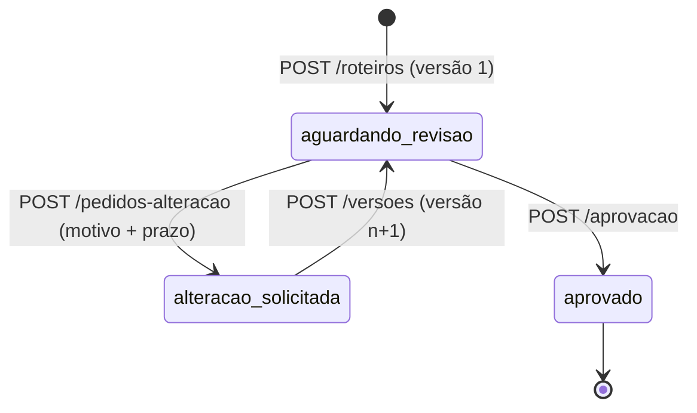

# Revisão de roteiro

API pequena para o fluxo de revisão de roteiro entre criador e marca. O criador envia o roteiro, a marca pede alteração com motivo e prazo, o criador manda outra versão e a marca aprova. Cada versão fica guardada com o próprio estado e o histórico de eventos pode ser consultado a qualquer momento.

Stack: Node 22+, TypeScript, Hono, `node:sqlite`, Vitest e k6 (via Docker) para carga.

## Como rodar

```bash
npm install
npm run dev          # API em http://localhost:3000, banco em data/roteiros.db
npm test             # unitários + integração (sqlite em memória, relógio controlado)
npm run typecheck
npm run load         # precisa de Docker; sobe a API na porta 3101 com banco temporário
```

`PORT` e `DB_PATH` mudam a porta e o arquivo do banco.

## Estados

O roteiro tem um estado só, e a resposta de `GET /roteiros/:id` traz `estado`, `versao_atual`, `acoes_permitidas` e o `pedido_alteracao_aberto`. Quem consome a API não precisa deduzir o que pode fazer a seguir.



Cada versão tem estado próprio: `aguardando_revisao`, `alteracao_solicitada` (a marca pediu mudança nela) ou `aprovada`. O texto e o número de uma versão nunca mudam. Um trigger no sqlite recusa `UPDATE` do conteúdo e `DELETE` de versão.

| Estado do roteiro | Ações permitidas | O que acontece com as outras |
|---|---|---|
| `aguardando_revisao` | `solicitar_alteracao`, `aprovar` | nova versão: 409 `AGUARDANDO_REVISAO` |
| `alteracao_solicitada` | `enviar_nova_versao` | aprovar ou pedir de novo: 409 `AGUARDANDO_NOVA_VERSAO` |
| `aprovado` | nenhuma | tudo: 409 `ROTEIRO_APROVADO` |

## Endpoints

| Método | Caminho | Corpo |
|---|---|---|
| POST | `/roteiros` | `{ "titulo", "conteudo" }` |
| GET | `/roteiros/:id` | |
| GET | `/roteiros/:id/versoes/:numero` | |
| GET | `/roteiros/:id/historico` | |
| POST | `/roteiros/:id/pedidos-alteracao` | `{ "motivo", "prazo": "AAAA-MM-DD", "versao"? }` |
| POST | `/roteiros/:id/versoes` | `{ "conteudo" }` |
| POST | `/roteiros/:id/aprovacao` | `{ "versao"? }` |

Os três `POST` sobre um roteiro aceitam o header opcional `Idempotency-Key`. O campo opcional `versao` serve para a marca dizer qual versão está revisando: se não for a atual, a resposta é 409 `VERSAO_DESATUALIZADA`.

Erros sempre vêm como `{ "error": { "code", "message" } }`: 400 para entrada inválida, 404 para roteiro ou versão inexistente, 409 para ação que o estado não permite e 422 para prazo vencido ou chave de idempotência reutilizada com outro corpo.

## Regras e onde elas estão

- Pedido de alteração sem motivo (ou só com espaços) ou sem prazo volta 400. A validação está em `validarMotivo` e `validarPrazo` (`src/dominio.ts`); os testes ficam em `test/integration/pedido-alteracao.test.ts` ("pedido de alteração exige motivo e prazo").
- O prazo é uma data civil `AAAA-MM-DD` no fuso da marca (`America/Sao_Paulo`) e vale até 23:59:59.999 desse dia em São Paulo. `fimDoDia` (`src/prazo.ts`) calcula esse instante com `Intl`, sem `-03:00` fixo. Os testes cobrem dias de 2018 e 2019 em que São Paulo tinha horário de verão.
- Pedido com prazo que já passou volta 422 `PRAZO_VENCIDO`. Os testes de integração usam relógio controlado com prazo `2026-03-12`: em `2026-03-13T02:59:59.999Z` o pedido passa, em `2026-03-13T03:00:00.000Z` ele é recusado. Em `2026-03-13T01:30:00Z`, quando o UTC já está no dia 13 e São Paulo ainda está no dia 12, o prazo do dia 12 continua valendo e o do dia 11 não.
- Aprovar encerra a revisão. Roteiro aprovado recusa nova versão, novo pedido e segunda aprovação com 409 `ROTEIRO_APROVADO` (`exigirAcao` em `src/dominio.ts`; testes em `fluxo.test.ts`, bloco "roteiro aprovado"). Um índice único parcial em `eventos` garante no banco uma aprovação por roteiro.
- A versão antiga continua consultável por `GET /roteiros/:id/versoes/1`, com o conteúdo original e o pedido de alteração que recebeu.
- Reenvio depois do prazo: decidi aceitar. A nova versão sai com `enviada_apos_prazo: true` e o evento `reenviado` registra `apos_prazo: true`. Recusar travaria o fluxo, porque o roteiro ficaria em `alteracao_solicitada` sem saída. Do jeito atual, a marca vê o atraso e decide se aprova ou pede outra alteração. O teste é "reenvio depois do prazo é aceito, marcado como enviado após o prazo, e a marca segue podendo decidir".
- O relógio é injetado (`src/clock.ts`). A regra de negócio não chama `Date.now()`.

## Exemplos reais

Saída de uma execução local com banco novo, em 2026-10-10. Rodei a API na porta 3101 e troquei para 3000 nos comandos abaixo; as respostas são as que voltaram. Encurtei as longas onde está indicado.

Criar o roteiro:

```bash
curl -s -X POST localhost:3000/roteiros -H 'content-type: application/json' \
  -d '{"titulo":"Campanha protetor solar","conteudo":"Abro mostrando o produto na praia e falo do FPS 50."}'
```

```json
{
  "id": "8ca7bd40-c76d-4a5a-b26b-f26fad648041",
  "titulo": "Campanha protetor solar",
  "estado": "aguardando_revisao",
  "versao_atual": 1,
  "acoes_permitidas": ["solicitar_alteracao", "aprovar"],
  "pedido_alteracao_aberto": null,
  "aprovacao": null,
  "versoes": [
    {
      "numero": 1,
      "estado": "aguardando_revisao",
      "conteudo": "Abro mostrando o produto na praia e falo do FPS 50.",
      "enviada_em": "2026-10-10T03:24:07.642Z",
      "enviada_apos_prazo": false,
      "pedido_alteracao": null
    }
  ],
  "criado_em": "2026-10-10T03:24:07.642Z",
  "atualizado_em": "2026-10-10T03:24:07.642Z"
}
```

Pedido sem motivo e pedido com prazo vencido:

```bash
curl -s -X POST localhost:3000/roteiros/$ID/pedidos-alteracao -H 'content-type: application/json' -d '{"prazo":"2026-10-17"}'
# HTTP 400
{"error":{"code":"MOTIVO_OBRIGATORIO","message":"Informe o motivo do pedido de alteração."}}

curl -s -X POST localhost:3000/roteiros/$ID/pedidos-alteracao -H 'content-type: application/json' -d '{"motivo":"Trocar o gancho","prazo":"2026-10-01"}'
# HTTP 422
{"error":{"code":"PRAZO_VENCIDO","message":"O prazo 2026-10-01 já passou no fuso da marca (America/Sao_Paulo)."}}
```

Pedido válido (HTTP 201, campo `versoes` omitido):

```bash
curl -s -X POST localhost:3000/roteiros/$ID/pedidos-alteracao -H 'content-type: application/json' \
  -d '{"motivo":"Trocar o gancho dos 3 primeiros segundos: começar com a pergunta.","prazo":"2026-10-17","versao":1}'
```

```json
{
  "id": "8ca7bd40-c76d-4a5a-b26b-f26fad648041",
  "estado": "alteracao_solicitada",
  "versao_atual": 1,
  "acoes_permitidas": ["enviar_nova_versao"],
  "pedido_alteracao_aberto": {
    "id": "2d24029f-8bed-4c73-805a-f63fab66c893",
    "versao": 1,
    "motivo": "Trocar o gancho dos 3 primeiros segundos: começar com a pergunta.",
    "prazo": "2026-10-17",
    "fuso": "America/Sao_Paulo",
    "prazo_fim": "2026-10-17T23:59:59.999-03:00",
    "prazo_fim_utc": "2026-10-18T02:59:59.999Z",
    "vencido": false,
    "criado_em": "2026-10-10T03:24:07.768Z"
  },
  "aprovacao": null
}
```

Aprovar com pedido aberto:

```bash
curl -s -X POST localhost:3000/roteiros/$ID/aprovacao -H 'content-type: application/json' -d '{}'
# HTTP 409
{"error":{"code":"AGUARDANDO_NOVA_VERSAO","message":"Há um pedido de alteração aberto; o criador precisa enviar uma nova versão antes."}}
```

Reenvio com `Idempotency-Key`. A segunda chamada com a mesma chave devolve a mesma resposta, com `idempotent-replayed: true`, e não cria versão 3:

```bash
curl -s -i -X POST localhost:3000/roteiros/$ID/versoes -H 'content-type: application/json' -H 'Idempotency-Key: reenvio-v1' \
  -d '{"conteudo":"Abro com a pergunta: você reaplica o protetor? Depois mostro o FPS 50."}'
# HTTP/1.1 201 Created
# ... "estado":"aguardando_revisao","versao_atual":2,"acoes_permitidas":["solicitar_alteracao","aprovar"] ...

# mesma chamada de novo
# HTTP/1.1 201 Created
# idempotent-replayed: true
```

Aprovação e tentativas depois dela:

```bash
curl -s -X POST localhost:3000/roteiros/$ID/aprovacao -H 'content-type: application/json' -d '{"versao":2}'
# HTTP 200 (trecho)
{"estado":"aprovado","versao_atual":2,"acoes_permitidas":[],"aprovacao":{"versao":2,"aprovado_em":"2026-10-10T03:24:07.816Z"}, ...}

curl -s -X POST localhost:3000/roteiros/$ID/aprovacao -H 'content-type: application/json' -d '{}'
curl -s -X POST localhost:3000/roteiros/$ID/versoes -H 'content-type: application/json' -d '{"conteudo":"mais uma"}'
curl -s -X POST localhost:3000/roteiros/$ID/pedidos-alteracao -H 'content-type: application/json' -d '{"motivo":"x","prazo":"2026-10-20"}'
# as três: HTTP 409
{"error":{"code":"ROTEIRO_APROVADO","message":"O roteiro já foi aprovado; a revisão está encerrada."}}
```

Versão antiga e histórico:

```bash
curl -s localhost:3000/roteiros/$ID/versoes/1
```

```json
{
  "numero": 1,
  "estado": "alteracao_solicitada",
  "conteudo": "Abro mostrando o produto na praia e falo do FPS 50.",
  "enviada_em": "2026-10-10T03:24:07.642Z",
  "enviada_apos_prazo": false,
  "pedido_alteracao": {
    "id": "2d24029f-8bed-4c73-805a-f63fab66c893",
    "versao": 1,
    "motivo": "Trocar o gancho dos 3 primeiros segundos: começar com a pergunta.",
    "prazo": "2026-10-17",
    "fuso": "America/Sao_Paulo",
    "prazo_fim": "2026-10-17T23:59:59.999-03:00",
    "prazo_fim_utc": "2026-10-18T02:59:59.999Z",
    "vencido": false,
    "criado_em": "2026-10-10T03:24:07.768Z"
  }
}
```

```bash
curl -s localhost:3000/roteiros/$ID/historico
```

```json
{
  "roteiro_id": "8ca7bd40-c76d-4a5a-b26b-f26fad648041",
  "eventos": [
    { "tipo": "enviado", "versao": 1, "ocorrido_em": "2026-10-10T03:24:07.642Z" },
    {
      "tipo": "alteracao_solicitada",
      "versao": 1,
      "ocorrido_em": "2026-10-10T03:24:07.768Z",
      "dados": {
        "motivo": "Trocar o gancho dos 3 primeiros segundos: começar com a pergunta.",
        "prazo": "2026-10-17",
        "prazo_fim": "2026-10-18T02:59:59.999Z"
      }
    },
    { "tipo": "reenviado", "versao": 2, "ocorrido_em": "2026-10-10T03:24:07.791Z", "dados": { "apos_prazo": false, "prazo": "2026-10-17" } },
    { "tipo": "aprovado", "versao": 2, "ocorrido_em": "2026-10-10T03:24:07.816Z" }
  ]
}
```

## Idempotência e concorrência

Cada caso de uso roda inteiro dentro de `BEGIN IMMEDIATE` (`transacao` em `src/db.ts`): lê o estado, aplica a regra e grava. Como o `DatabaseSync` é síncrono e a API roda num processo só, duas requisições nunca intercalam entre a leitura e a escrita. O banco também se protege sozinho: a chave primária `(roteiro_id, numero)` impede versão duplicada, `UNIQUE (roteiro_id, versao)` impede dois pedidos para a mesma versão e o índice único parcial impede uma segunda aprovação.

Com `Idempotency-Key`, a primeira resposta de sucesso fica gravada em `chaves_idempotencia` junto com uma impressão da operação e do corpo. Repetições recebem a mesma resposta. A mesma chave com outro corpo recebe 422. Erros não ficam gravados, então uma chave usada cedo demais (por exemplo, reenvio antes do pedido de alteração) volta a funcionar quando o estado permitir.

Os testes em `test/integration/concorrencia.test.ts` disparam com `Promise.all` 20 reenvios com a mesma chave (sai uma versão), 20 reenvios sem chave (um 201, o resto 409), 30 aprovações (uma 200, 29 de 409) e uma disputa entre aprovar e pedir alteração na mesma versão (só uma vence).

## Por que essa solução

Revisão de roteiro é um fluxo de baixa frequência: algumas ações por roteiro, espalhadas ao longo de dias. Um processo Node com sqlite serializando as escritas dá conta dessa escala com folga, e as garantias ficam em restrições do banco que eu consigo testar. Não usei Redis nem lock distribuído porque não existe efeito colateral fora do banco (nenhuma notificação ou chamada externa dentro da transação), então a transação resolve.

Com várias instâncias, eu passaria para Postgres mantendo as mesmas restrições únicas, faria `SELECT ... FOR UPDATE` na linha do roteiro dentro da transação e deixaria a tabela de idempotência no mesmo banco. Lock distribuído só entraria se aparecesse um efeito externo que não cabe na transação, e mesmo nesse caso eu tentaria antes um outbox.

## Teste de carga

`npm run load` sobe a API na porta 3101 com banco temporário e roda `load/revisao.js` no k6 (Docker, `grafana/k6:0.54.0`). São 100 usuários virtuais por 20 s disputando 10 roteiros, 10 por roteiro. Cada um lê o estado e age: pede alteração na versão atual, reenvia com a mesma `Idempotency-Key` que os outros que viram a mesma versão, aprova (metade com chave, metade sem) ou, depois de aprovado, tenta aprovar e reenviar de novo esperando 409 `ROTEIRO_APROVADO`. Os limites são `http_req_failed < 1%`, `p(95) < 300ms` e `checks > 99%`. No fim, `scripts/verify-load.ts` lê o banco e falha se algum roteiro tiver versões com buraco ou repetidas, conteúdo trocado entre versões, versão substituída sem pedido, mais de uma aprovação ou evento depois da aprovação.

Resultado de uma execução no meu Mac (trecho real da saída):

```
✓ checks.........................: 100.00% 88630 out of 88630
✓ http_req_duration..............: avg=22.48ms min=166.33µs med=20.76ms max=833.32ms p(90)=30.14ms p(95)=36.01ms
✓ http_req_failed................: 0.00%   0 out of 88640
  http_reqs......................: 88640   4423.028223/s
  aprovacoes_aceitas.............: 10
  reenvios_201...................: 2605
verificação: 10 roteiros, 500 versões, 10 aprovados
invariantes ok: uma aprovação por roteiro, versões 1..n sem buraco nem duplicata, versões antigas preservadas
```

## O que ficou de fora

- Autenticação e papéis. Qualquer cliente pode agir como marca ou como criador, e a API não registra quem fez cada ação.
- Notificação ao criador quando chega um pedido (e à marca quando chega versão nova).
- Listagem e busca de roteiros. Só existe consulta por id.
- `POST /roteiros` não aceita `Idempotency-Key`, porque a chave é guardada por roteiro e na criação ainda não há roteiro.
- O fuso é fixo em `America/Sao_Paulo` para todas as marcas.
- Upload, vídeo e interface, como o enunciado permite.

## Decisões que eu deixaria diferentes com mais tempo

- O fuso viria do cadastro da marca, guardado junto do pedido, em vez de uma constante.
- O reenvio após o prazo é aceito e marcado. Com mais conversa com o produto, talvez a marca devesse poder escolher por campanha entre aceitar, recusar ou prorrogar o prazo, e prorrogação viraria um evento próprio.
- A resposta de `GET /roteiros/:id` traz todas as versões com conteúdo. Funciona para roteiros com poucas versões, mas na carga, com 50 versões por roteiro, o k6 recebeu 693 MB em 20 s. Eu paginaria as versões e deixaria o conteúdo só no endpoint da versão.
- O histórico guarda `dados` como JSON livre. Eu tiparia por tipo de evento e incluiria o autor de cada ação.
- As chaves de idempotência nunca expiram. Colocaria um prazo de validade e uma limpeza periódica.
- A resposta repetida por idempotência é a foto do momento da primeira chamada, então pode estar desatualizada em relação ao estado atual. É o comportamento comum, mas vale documentar no contrato da API.

## Uso de IA

O código, os testes e este README foram produzidos com Claude Code (Claude Opus) a partir do enunciado do desafio. A IA também rodou os testes, o teste de carga e os exemplos com curl que aparecem acima.

O que eu revisei: revisei as regras de negócio e os testes, rodei a suíte e o teste de carga localmente e conferi os exemplos do README contra a API rodando.
